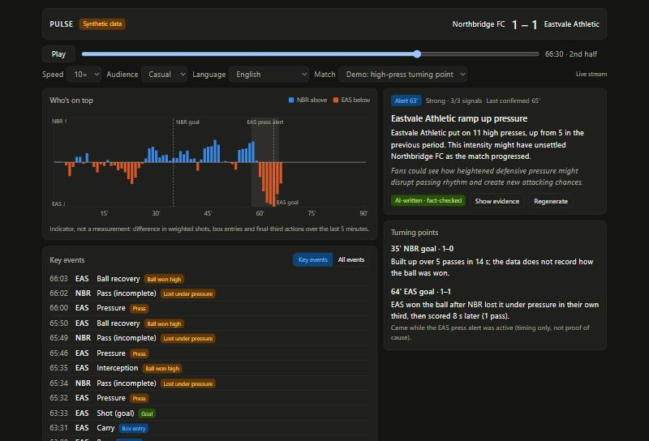
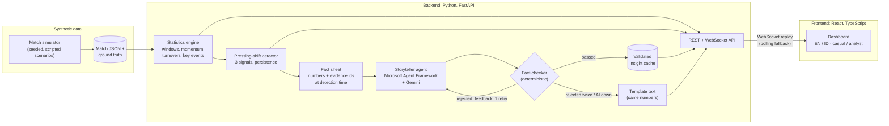

# PULSE: the story behind the score

PULSE replays a football match and explains, in real time, **what changed and why it might matter**. A tactical detector watches the event stream minute by minute. When it finds a real shift (for example a team suddenly pressing much higher), an AI Storyteller agent turns the verified numbers into a short insight for **fans or analysts**, in **English or Bahasa Indonesia**. Every number in that text is checked automatically against the data before anyone sees it.

**Live demo:** https://pulse-k9mh.onrender.com
(free hosting: if nobody has visited for 15 minutes, the first load takes about a minute while the server wakes up)

> All match data is **synthetic**: generated by our own simulator for this demo, as the hackathon rules require. No real match or player data is used.



## What you can do

- **Replay a match** at 1–60× speed, pause, or jump to any minute. Nothing from the future is ever shown: every view is computed only from events before the current match time.
- **See who's on top:** a minute-by-minute momentum balance (home above the middle line, away below), with alert windows and goals marked.
- **Follow key events,** not every pass: goals, shots, key passes, box entries, high ball wins and pressing actions are labelled automatically. Analysts can switch to all events.
- **Read the insight** when PULSE raises an alert, written for a **casual fan** or an **analyst**, in **English or Indonesian**. It's labelled "AI-written · fact-checked" or "Template text", with **evidence**: a before/now table and the exact events the text cites.
- **Understand each goal:** turning points trace every goal back to how the move started (for example "won the ball after a pass lost under pressure in their own third, scored 8 s later").
- **Analyst view** adds a numbers panel (last 5 minutes vs whole match), chart scale values and pitch zones.

## Architecture



**Design principle:** the AI never calculates anything. Statistics, detection and turning points are plain, tested Python. The model's only job is to *word* a fact sheet. A deterministic fact-checker then rejects any text that:
- uses a number not in the facts, or cites an event outside the evidence;
- states cause and effect without hedging (in English and Indonesian);
- uses the wrong decimal format for the language, or English terms leaking into Indonesian;
- for fans, uses more than 2 statistics or any rate or percentage.

A rejected draft goes back to the agent once, with the checker's reasons. If it fails again, or the AI is unavailable, PULSE shows a template text built from the same verified numbers. The page never waits for the AI: validated texts are cached, and live regeneration is capped at 20 per day and runs one at a time.

### Agentic design

| Role | Kind | What it does |
|---|---|---|
| Detector | Deterministic | Compares the last 5 minutes with the 15 before, every match minute; raises an alert only if the shift persists |
| Fact-sheet builder | Deterministic | Freezes the numbers and evidence at the moment of detection, so the story can't leak the future |
| **Storyteller** | **LLM agent** (Microsoft Agent Framework `Agent`, Gemini via its OpenAI-compatible API, structured output) | Writes headline, summary and hedged interpretation per audience and language |
| Fact-checker | Deterministic | Validates every claim, number, cited event and phrasing rule; feeds its reasons back to the Storyteller |
| Fallback | Deterministic | Guarantees a correct, labelled text when the agent can't deliver |

## Honest evaluation

The detector was tuned on one set of simulated matches and then measured on **fresh, unseen seeds (300–309)**, with the decision rule fixed in advance:

| Test (10 matches each) | Result |
|---|---|
| Planted pressing shift detected | **9 / 10** (mostly 55'–63') |
| False alerts, matches with a planted shift and a short decoy burst | **6** (3 of them during the decoy burst) |
| False alerts, matches with no planted shift | **4** (≈ 0.4 per match) |
| Demo match (seed 42) | 1 alert at 62', 0 false alerts |

A statistical alternative (a rate test, "v3") made fewer false alerts but **missed the demo match**, so the simpler version was kept. Both are in the code. The known shortfalls are kept as strict `xfail` tests rather than tuned away.

**Tests:** 165 backend tests (pytest) cover the schema, simulator, statistics, detector, fact-checker, agent pipeline (with fake models, no network), API, WebSocket replay and the no-future-data guarantee. The frontend passes ESLint and a strict TypeScript build.

## Limitations

- **Synthetic data.** Patterns exist because the simulator planted them. Real event data would be noisier, and the detector would need re-validation.
- **No tracking data.** Pressing is estimated from pressure events and where balls are lost, not from player positions.
- **False alerts happen,** about 0.4 per match without a real shift, especially after short intense bursts. The UI shows confidence and evidence so users can judge.
- **"Momentum" is an indicator, not a measurement:** a weighted count of shots, box entries and final-third actions.
- **The fact-checker is rule-based.** It catches numbers, evidence and listed causal phrases, but not every possible overstatement.
- **Free hosting:** about a minute of cold start; live regeneration depends on Gemini's free tier.

## Run it locally

Requirements: Python 3.13, Node.js 22+ (24 recommended).

```bash
# Backend
cd backend
python -m venv .venv
.venv\Scripts\Activate.ps1        # Windows PowerShell (macOS/Linux: source .venv/bin/activate)
pip install -r requirements.lock
python -m pytest -q               # 165 passed, 3 xfailed
uvicorn app.main:app --port 8000
```

```bash
# Frontend (second terminal)
cd frontend
npm ci
npm run dev                       # http://localhost:5173 (proxies /api to the backend)
```

**AI is optional.** Without a key, cached insights and template texts still work. To enable live generation, copy `backend/.env.example` to `backend/.env` and fill in a free Google AI Studio key and model. `.env` is git-ignored.

Useful scripts (from `backend/`):

| Command | Purpose |
|---|---|
| `python -m scripts.generate_matches` | Regenerate the synthetic matches and their ground truth |
| `python -m scripts.evaluate_detector` | Re-run the detector evaluation on fresh seeds |
| `python -m scripts.run_live_insights --save` | Generate and fact-check the cached AI insights |

## Project structure

```
backend/app/
  schema/      event + match models (validated, synthetic-only)
  simulator/   seeded match generator and scenarios
  stats/       windows, momentum, turnovers, key events, turning points
  detection/   pressing-shift detector and evaluation
  narrative/   fact sheets, Storyteller agent, fact-checker, fallback, cache
  api/         REST endpoints, insight service, WebSocket replay
frontend/src/  React dashboard (replay hook, chart, feed, insight card, EN/ID strings)
data/          synthetic matches + cached validated insights
render.yaml    one-service deployment on Render (free plan)
```

## Built with

Python, FastAPI, Pydantic, **Microsoft Agent Framework**, Google Gemini (free tier), React, TypeScript, Vite, Recharts, Render.

Developed with the help of Claude Code (an AI coding assistant) for design discussion, code and reviews. All results above were produced by running the code.
