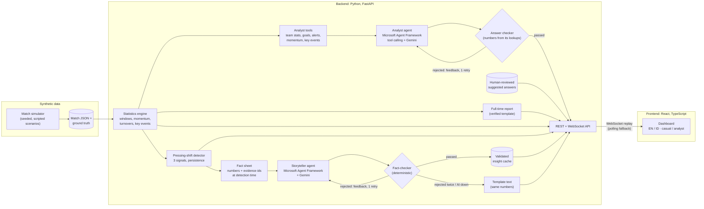

# PULSE: the story behind the score

PULSE replays a football match and explains, in real time, **what changed and why it might matter**. A tactical detector watches the event stream minute by minute. When it finds a real shift (for example a team suddenly pressing much higher), an AI Storyteller agent turns the verified numbers into a short insight for **fans or analysts**, in **English or Bahasa Indonesia**. Every number in that text is checked automatically against the data before anyone sees it. At the final whistle, PULSE writes a **full-time report** and lets you **ask an Analyst agent** follow-up questions, answered by looking up the match data with tools and fact-checked the same way.

**Who it's for:** broadcasters, club media teams and sports apps that want automated, multilingual match commentary they can **trust**: explainable, auditable, and safe to run unattended.

**Live demo:** https://pulse-k9mh.onrender.com
(free hosting: if nobody has visited for 15 minutes, the first load takes about a minute while the server wakes up)

> All match data is **synthetic**: generated by our own simulator for this demo, as the hackathon rules require. No real match or player data is used.

<p align="center">
  
  
</p>

## What you can do

- **Replay a match** at 1–60× speed, pause, or jump to any minute. Nothing from the future is ever shown: every view is computed only from events before the current match time.
- **See who's on top:** a minute-by-minute momentum balance (home above the middle line, away below), with alert windows and goals marked.
- **Follow key events,** not every pass: goals, shots, key passes, box entries, high ball wins and pressing actions are labelled automatically. Analysts can switch to all events.
- **Read the insight** when PULSE raises an alert, written for a **casual fan** or an **analyst**, in **English or Indonesian**. It's labelled "AI-written · fact-checked" or "Template text", with **evidence**: a before/now table and the exact events the text cites.
- **Understand each goal:** turning points trace every goal back to how the move started (for example "won the ball after a pass lost under pressure in their own third, scored 8 s later").
- **See it on the pitch:** each goal's build-up drawn step by step, and a press map of the events behind a pressing alert.
- **Analyst view** adds a numbers panel (last 5 minutes vs whole match), chart scale values and pitch zones.
- **Read the full-time report** at the final whistle: headline, the key moments in match order and a hedged takeaway, built from a verified full-time fact sheet.
- **Ask the analyst:** tap a suggested question or type your own ("Who pressed more in the second half?"). An AI agent looks the answer up with PULSE's tools, the answer is fact-checked, and the card shows what it looked at ("Looked at: team stats 45'–90'"). Off-topic questions are politely declined.

## Built to be trusted in production

PULSE is designed around one rule: **AI may word the story, but it never decides the facts.** That is what makes automated commentary usable by a media business.

| Need | How PULSE handles it |
|---|---|
| **Accuracy** | Statistics, detection and turning points are deterministic, tested Python. The AI only words a frozen fact sheet. A fact-checker rejects any unsupported number, uncited event, unhedged cause-and-effect or wrong-language formatting before publication. |
| **Transparency** | Every insight is labelled ("AI-written · fact-checked" or "Template text" with the reason) and carries its evidence: the before/now numbers and the exact events cited. Every answer shows which tools the agent used and whether it is a human-reviewed or a live AI answer. Model name and prompt version are recorded with each text. |
| **Human in the loop where it matters** | The fact-checker catches wrong numbers, not every wrong meaning. So the answers to suggested questions (what most users and the demo see) are approved by a person before they are served, and the full-time report uses the verified template: AI report drafts passed the number checks but still mixed up who lost the ball where, so we chose correctness over prose. |
| **Reliability** | The page never waits for the AI. Validated texts are cached, and if the model is slow, down or rejected twice, a template built from the same verified numbers is shown. The replay falls back from WebSocket to polling automatically. |
| **Cost and abuse controls** | Live generation runs one at a time with daily caps: 20 insight regenerations, and 60 model calls for questions (every tool round counts, measured by Agent Framework middleware). Questions are limited to 200 characters and to this match; each answer is capped at 4 model rounds. Cached insights and reviewed answers cost nothing to serve. The model is chosen by configuration, so it can be swapped without code changes. |
| **No spoilers, no leakage** | Every view, alert, label and insight uses only events before the current match time, enforced by tests. Insights are frozen at detection time. |
| **Auditability** | The detector was measured on unseen data with the decision rule fixed in advance (see below). Known weaknesses are kept as failing-by-design tests, not hidden. |
| **Security** | API keys live only in environment variables and are never committed. The git history was scanned for secrets before publishing. |
| **Operations** | One service, health-checked endpoint, configuration through environment variables, automatic redeploy on push, 225 automated tests. |

### Path to adoption

1. **Plug in a real event feed.** The event schema (passes, carries, shots, pressures, tackles...) follows standard football event data, so a provider feed needs an adapter, not a redesign. The detector must then be re-validated on real matches.
2. **Add the next detectors** (for example a drop in pressing, or a team pinned back) using the same detect, fact-sheet, write, check pattern.
3. **Production hardening still to do:** user authentication and per-customer rate limits, a persistent shared cache instead of a file, monitoring and alerting, and turning today's command-line review of suggested answers into an editor review queue in the UI.

## Architecture



**Design principle:** the AI never calculates anything. Statistics, detection and turning points are plain, tested Python. The model's only job is to *word* a fact sheet. A deterministic fact-checker then rejects any text that:
- uses a number not in the facts, or cites an event outside the evidence;
- states cause and effect without hedging (in English and Indonesian);
- uses the wrong decimal format for the language, or English terms leaking into Indonesian;
- for fans, uses more than 2 statistics or any rate or percentage.

A rejected draft goes back to the agent once, with the checker's reasons. If it fails again, or the AI is unavailable, PULSE shows a template text built from the same verified numbers. The page never waits for the AI: validated texts are cached, and live regeneration is capped at 20 per day and runs one at a time.

### Agentic design

| Role | Kind | What it does |
|---|---|---|
| Detector | Deterministic | Compares the last 5 minutes with the 15 before, every match minute; raises an alert only if the shift persists |
| Fact-sheet builder | Deterministic | Freezes the numbers and evidence at the moment of detection, so the story can't leak the future |
| **Storyteller** | **LLM agent** (Microsoft Agent Framework `Agent`, Gemini via its OpenAI-compatible API, structured output) | Writes headline, summary and hedged interpretation per audience and language |
| Fact-checker | Deterministic | Validates every claim, number, cited event and phrasing rule; feeds its reasons back to the Storyteller |
| Fallback | Deterministic | Guarantees a correct, labelled text when the agent can't deliver |
| **Analyst** | **LLM agent with tools** (Microsoft Agent Framework `Agent` with 5 function tools, Gemini) | Answers post-match questions by deciding which data to look up: team stats for a minute range, goals and how they started, pressing alerts, momentum phases, key events |
| Analyst tools | Deterministic | Return plain sentences ("Northbridge FC lost the ball under pressure from Eastvale Athletic") and log every number they show in a per-question fact ledger |
| Answer checker | Deterministic | Accepts only numbers from that question's lookups, hedged causes, no claims of intent; one retry with feedback, then an honest "couldn't verify" with the data found |
| Human reviewer | Person | Approves the suggested-question answers before they are served |

Gemini 3 models require a "thought signature" to be sent back with every tool call. Agent Framework's OpenAI-compatible client drops it, so PULSE adds a small client subclass that keeps it (`backend/app/narrative/gemini_client.py`), guarded by tests that fail if the framework's internals change.

## Honest evaluation

The detector was tuned on one set of simulated matches and then measured on **fresh, unseen seeds (300–309)**, with the decision rule fixed in advance:

| Test (10 matches each) | Result |
|---|---|
| Planted pressing shift detected | **9 / 10** (mostly 55'–63') |
| False alerts, matches with a planted shift and a short decoy burst | **6** (3 of them during the decoy burst) |
| False alerts, matches with no planted shift | **4** (≈ 0.4 per match) |
| Demo match (seed 42) | 1 alert at 62', 0 false alerts |

A statistical alternative (a rate test, "v3") made fewer false alerts but **missed the demo match**, so the simpler version was kept. Both are in the code. The known shortfalls are kept as strict `xfail` tests rather than tuned away.

**Tests:** 225 backend tests (pytest) cover the schema, simulator, statistics, detector, fact-checkers, agent pipelines (with fake models, no network), the analyst tools and tool-calling loop, the daily model-call cap, API, WebSocket replay and the no-future-data guarantee. The frontend passes ESLint and a strict TypeScript build.

## Limitations

- **Synthetic data.** Patterns exist because the simulator planted them. Real event data would be noisier, and the detector would need re-validation.
- **No tracking data.** Pressing is estimated from pressure events and where balls are lost, not from player positions.
- **False alerts happen,** about 0.4 per match without a real shift, especially after short intense bursts. The UI shows confidence and evidence so users can judge.
- **"Momentum" is an indicator, not a measurement:** a weighted count of shots, box entries and final-third actions.
- **The fact-checkers are rule-based.** They catch numbers, evidence and listed causal phrases, but not meaning errors (for example which team was under pressure). That is why the full-time report is a template and suggested answers are human-reviewed; live free-text answers are labelled as such and can still be imperfectly worded.
- **Free hosting:** about a minute of cold start; live regeneration depends on Gemini's free tier.

## Run it locally

Requirements: Python 3.13, Node.js 22+ (24 recommended).

```bash
# Backend
cd backend
python -m venv .venv
.venv\Scripts\Activate.ps1        # Windows PowerShell (macOS/Linux: source .venv/bin/activate)
pip install -r requirements.lock
python -m pytest -q               # 225 passed, 3 xfailed
uvicorn app.main:app --port 8000
```

```bash
# Frontend (second terminal)
cd frontend
npm ci
npm run dev                       # http://localhost:5173 (proxies /api to the backend)
```

**AI is optional.** Without a key, cached insights, template texts, the full-time report and reviewed answers still work; only live questions and regeneration need it. To enable live generation, copy `backend/.env.example` to `backend/.env` and fill in a free Google AI Studio key and model. `.env` is git-ignored.

Useful scripts (from `backend/`):

| Command | Purpose |
|---|---|
| `python -m scripts.generate_matches` | Regenerate the synthetic matches and their ground truth |
| `python -m scripts.evaluate_detector` | Re-run the detector evaluation on fresh seeds |
| `python -m scripts.run_live_insights --save` | Generate and fact-check the cached AI insights |
| `python -m scripts.run_live_answers --match demo-high-press --review` | Generate answers to the suggested questions and save the ones you approve |
| `python -m scripts.run_live_questions` | Ask the Analyst agent a few questions and print what it looked at |
| `python -m scripts.check_tools` | Check that tool calling works with your Gemini model |

## Project structure

```
backend/app/
  schema/      event + match models (validated, synthetic-only)
  simulator/   seeded match generator and scenarios
  stats/       windows, momentum, turnovers, key events, turning points
  detection/   pressing-shift detector and evaluation
  narrative/   fact sheets, Storyteller agent, fact-checker, fallback, cache, Gemini client
  report/      full-time fact sheet + report, Analyst agent, tools, answer checker, suggested answers
  api/         REST endpoints, insight service, WebSocket replay
frontend/src/  React dashboard (replay hook, chart, feed, insight card, pitch view, report, Q&A, EN/ID strings)
data/          synthetic matches, cached validated insights, reviewed answers
render.yaml    one-service deployment on Render (free plan)
```

## Built with

Python, FastAPI, Pydantic, **Microsoft Agent Framework**, Google Gemini (free tier), React, TypeScript, Vite, Recharts, Render.

Developed with the help of Claude Code (an AI coding assistant) for design discussion, code and reviews. All results above were produced by running the code.
